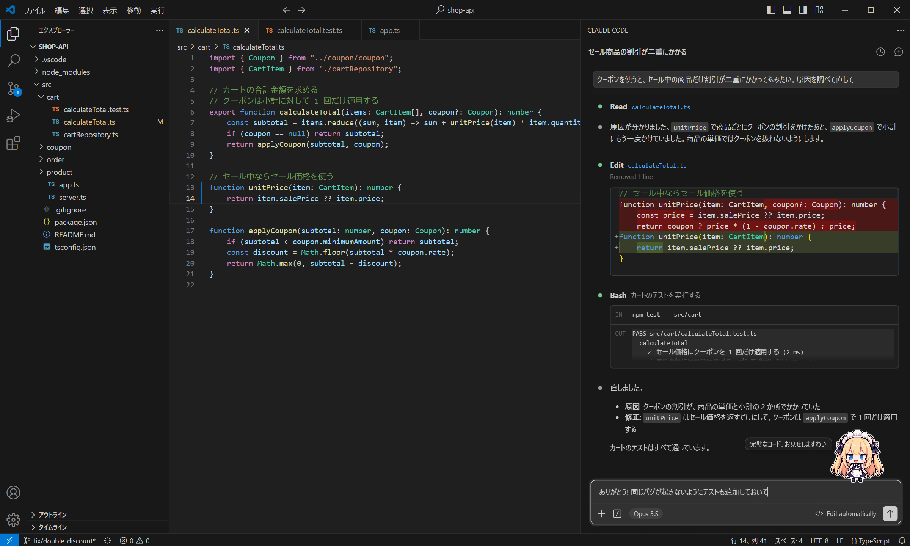
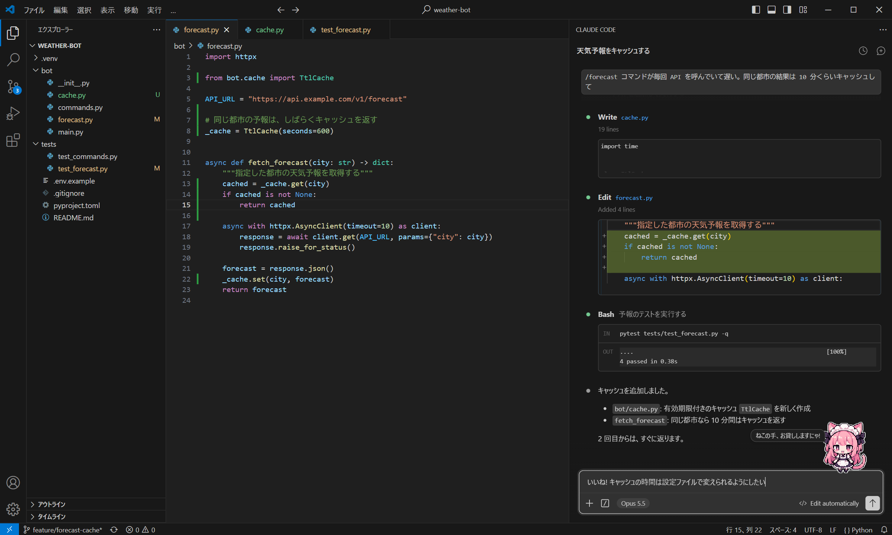
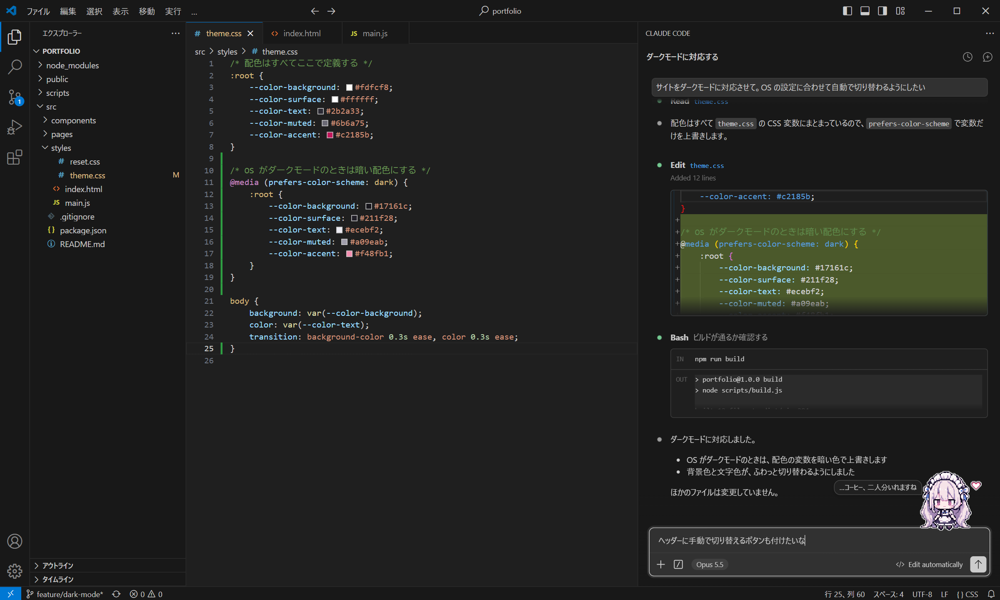

# Claude Maid

Claude Code のチャット入力欄右上に、ちっちゃいメイドさんを常駐させます。

- チャットを開くたびに、ランダムなメイドさんが 1 人やってきます
- 入力欄をクリックするとセリフを話します
- マウスを近づけると透けて、後ろの文字が読めます
- ゆらゆら待機モーションと、ときどきにっこりまばたき
- Claude Code が更新されても自動で再配置します

## スクリーンショット

金髪メイド

猫耳メイド

お姉さんメイド

## 仕組み

VS Code の拡張機能は、ほかの拡張機能の Webview の中には描画できません。
そこで Claude Code の `webview/index.css` の末尾に、メイドさん用の CSS を目印コメントで挟んで追記しています。
CSS には乱数がないので、誰が出てくるかとセリフを選ぶ小さなスクリプトだけを、
同じく目印コメントで挟んで `webview/index.js` の末尾に追記しています。
「お休みさせる」やアンインストールで、どちらも元どおりに取り除きます。

## コマンド(Ctrl+Shift+P)

| コマンド | 内容 |
| --- | --- |
| Claude Maid: メイドさんを呼ぶ | 表示する |
| Claude Maid: メイドさんをお休みさせる | CSS を取り除く |
| Claude Maid: メイドさんを再配置する | 手動で再適用する |

## 設定

| 設定 | 内容 |
| --- | --- |
| `claudeMaid.character` | 開くたびにランダムか、特定の子を配置する |
| `claudeMaid.size` | 大きさ。100 で 1ドット = 1px |
| `claudeMaid.offsetRight` | 入力欄の右端からの距離 ( px ) |
| `claudeMaid.fadeOpacity` | マウスを近づけたときの不透明度 |
| `claudeMaid.showGreeting` | 吹き出しで話すかどうか |
| `claudeMaid.greeting` | キャラクターのセリフ、空ならメイドさんごとの専用のセリフ |
| `claudeMaid.greetingSeconds` | 吹き出しを表示する秒数 |
| `claudeMaid.imagePath` | 好きな画像の絶対パス。指定すると、ほかのキャラクターにも差し替えられる |

## インストール

VS Code の拡張機能ビューで「Claude Maid」を検索してインストールしてください。
Claude Code の拡張機能が入っていない場合は、一緒にインストールされます。

インストールしたら、ウィンドウを再読み込みしてください。
アンインストールすると、追記した CSS も自動で取り除かれます。

## ライセンス

[MIT](LICENSE)
